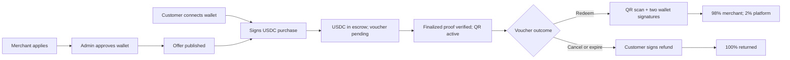
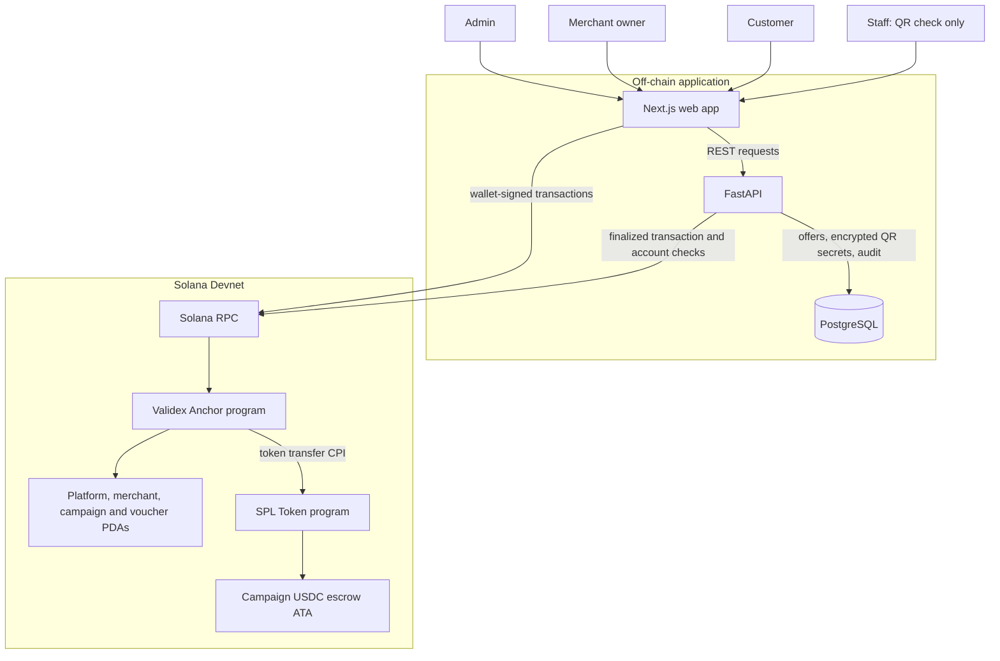
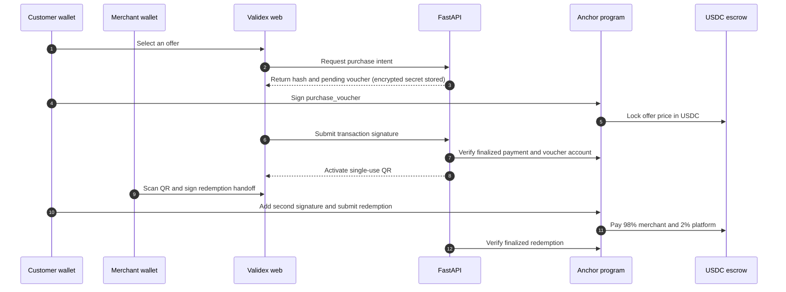

# Validex

**Local offers that customers can actually verify.** Validex is a Solana-based marketplace prototype where independent neighborhood businesses sell limited, single-use vouchers in USDC. Payment sits in campaign escrow until a customer and merchant jointly approve redemption; an unused voucher can be refunded after cancellation or expiry.

> **Hackathon status, October 2026:** The Anchor program is [deployed on Solana Devnet](https://explorer.solana.com/address/5ohDEoj3QVVXSG82Fwru8BMuLP45dLWCPrirquzenmbh?cluster=devnet), and the web app, API, unit tests, and local-validator transaction test are available. **Platform initialization and a real Solflare purchase/redemption on Devnet are still pending.** This is a testnet prototype, not a live merchant service or a claim of completed customer payments.

[How it works](#how-it-works) · [Product tour](#product-tour) · [Architecture](#architecture-at-a-glance) · [Run locally](#run-locally) · [Verification](#verification-status) · [Hackathon submission pack](docs/hackathon-submission.md)

## The problem

Local businesses often rely on intermediaries to sell promotions, while customers have little independent proof that a voucher is valid, unused, or refundable. A screenshot of a coupon is easy to copy; an off-chain status page alone asks both sides to trust the marketplace operator.

Validex separates discovery from settlement. The API makes offers searchable and handles encrypted QR secrets, but the Solana program enforces inventory, voucher ownership, one-time use, USDC escrow, and payout rules. Neither the API nor a staff member can release escrow by themselves.

## How it works

1. **Business onboarding.** A merchant applies with their Solana wallet. The administrator reviews the application and registers an approved wallet on-chain.
2. **Offer creation.** The merchant publishes a campaign with a USDC price, stock, dates, and per-wallet limit. The campaign has its own escrow token account.
3. **Purchase.** The customer signs a Solana transaction in Solflare or Phantom. The program checks the limits and moves the exact USDC price into campaign escrow.
4. **Voucher activation.** The API checks the transaction and voucher account at `finalized` commitment before showing an active, single-use QR voucher. A submitted or merely pending transaction is not treated as payment.
5. **Redemption.** The merchant scans the QR. Both the merchant owner and customer sign the same redemption transaction. The program marks the voucher used and atomically pays **98% to the merchant and 2% to the platform**.
6. **Refund when eligible.** If the campaign is cancelled or expires, the owner of an unused voucher may sign a full refund from escrow. A redeemed or already refunded voucher cannot be used again.

This is the implemented and locally tested transaction path; the real-wallet Devnet run is still pending.



For example, a 10 USDC voucher stays in escrow after purchase. On successful redemption, 9.80 USDC goes to the merchant and 0.20 USDC to the platform. If it qualifies for a refund instead, the customer receives the full 10 USDC. This example describes the program rules, **not a completed Devnet sale**.

## Product tour

| View | What it shows | Local route |
| --- | --- | --- |
| Marketplace | Offer discovery and campaign details | [`/`](http://localhost:3000/) |
| Merchant dashboard | Application, campaign management, and QR verification | [`/isletme`](http://localhost:3000/isletme) |
| Customer dashboard | Purchases and voucher details | [`/musteri`](http://localhost:3000/musteri) |
| Admin center | Application review, on-chain merchant registration, and one-time Devnet platform setup | [`/yonetim`](http://localhost:3000/yonetim) |

These are **local** links, not a publicly hosted demo. The interface is in English; route names are retained for compatibility. Light and dark themes are available. Product screenshots and two submission videos have not yet been published, so none are represented here as finished evidence.

## Architecture at a glance

The web app builds transactions for users to approve in their own wallets. FastAPI handles discovery and verifies finalized on-chain proofs; PostgreSQL stores application records and encrypted QR secrets. The Anchor program, not the API, controls voucher state and USDC escrow.



### Voucher lifecycle

The purchase and redemption paths cross the off-chain/on-chain boundary only after wallet approval. A merchant-signed redemption handoff still needs the customer's signature; a QR scan alone never pays the merchant.



After cancellation or expiry, an unused voucher follows a separate customer-signed **full-refund** path instead of redemption. See the [architecture notes](docs/architecture.md) for account and trust-boundary details.

## Verification status

| Layer | Evidence | Current result |
| --- | --- | --- |
| Anchor program | [Devnet program](https://explorer.solana.com/address/5ohDEoj3QVVXSG82Fwru8BMuLP45dLWCPrirquzenmbh?cluster=devnet) and [deployment transaction](https://explorer.solana.com/tx/aD2TYH9rNgMAtpgpsUti4ToVvyCmrczsNVc4Gvmy2yF7nLdwnNpXwU2nxcNYGNcoP3DD1iXpbM4tffipGFrWyCB?cluster=devnet) | Deployed; upgrade authority is the admin wallet |
| Program rules | `cargo test -p validex --lib` | 9 unit tests passed |
| Local Solana transactions | [`apps/web/tests/validex-localnet.mjs`](apps/web/tests/validex-localnet.mjs) | Passed purchase, invalid-account, limit, redemption, fee, cancellation, and refund checks on a local validator |
| Web and API | `npm run verify`; `python -m pytest -q` | 13 web tests, production build, and 63 API tests passed |
| Real-wallet Devnet flow | Solflare purchase → finalized voucher → two-party redemption or refund | **Not yet completed**; platform initialization, merchant setup, and test USDC are required |

The source of truth for an on-chain payment is the finalized transaction, not a UI success message. See the [submission pack](docs/hackathon-submission.md) for the remaining end-to-end recording checklist.

## Run locally

You need Docker Desktop with Docker Compose. A browser with a Solflare or Phantom extension is needed for wallet actions; an embedded browser without that extension cannot show wallet approval prompts.

```powershell
git clone https://github.com/BerzanBaran/Validex.git
cd Validex
Copy-Item .env.example .env
# Replace VALIDEX_JWT_SECRET and VALIDEX_VOUCHER_ENCRYPTION_SECRET
# in .env with two different, random values before using the API.
docker compose up --build
```

Open [the marketplace](http://localhost:3000/) or [API documentation](http://localhost:8000/docs). The example environment contains public Devnet addresses, not private wallet keys. Keep `.env`, wallet keypairs, recovery phrases, and API tokens out of Git. The Compose database credentials and development server settings are **local-development defaults**, not production configuration.

Browsing the app does not require a funded wallet. To run the real Devnet payment flow, the administrator must first initialize the platform from `/yonetim` with the configured admin wallet, approve/register a merchant, and have that merchant publish a campaign. The customer then needs **Devnet SOL for fees** and **Circle Devnet USDC for the voucher price**. Those setup steps are not automated or claimed complete here.

### Run the checks

```powershell
cd apps/web
npm ci
npm run verify

cd ../../services/api
python -m pip install -e ".[dev]"
python -m pytest -q
```

The Anchor program requires Rust, Solana CLI, and Anchor; see the [program guide](programs/README.md) for local-validator and build instructions. The deployed Devnet build uses sBPFv2. The local-validator transaction script expects a **fresh validator and its test-admin build**; it is not a command to run against Devnet.

## Devnet configuration

| Item | Value |
| --- | --- |
| Network | Solana Devnet |
| Validex program | [`5ohDEoj3QVVXSG82Fwru8BMuLP45dLWCPrirquzenmbh`](https://explorer.solana.com/address/5ohDEoj3QVVXSG82Fwru8BMuLP45dLWCPrirquzenmbh?cluster=devnet) |
| Circle Devnet USDC mint | [`4zMMC9srt5Ri5X14GAgXhaHii3GnPAEERYPJgZJDncDU`](https://developers.circle.com/stablecoins/usdc-contract-addresses) |
| Platform account | **Not initialized as of this README update** |

The admin **public** address is pinned into the Anchor program at build time. Web and API environment variables must use the same program ID, RPC network, and USDC mint. A future program upgrade requires the admin wallet's explicit signature; no keypair is committed to this repository.

## Repository map

```text
Validex/
├── apps/web/             Next.js marketplace and customer/merchant/admin views
├── services/api/         FastAPI, PostgreSQL models, auth, transaction verification
├── programs/validex/     Anchor voucher, campaign, and escrow program
├── docs/                 Architecture, demo data, roadmap, submission pack
├── Anchor.toml           Solana program IDs and local Anchor settings
└── compose.yaml          Local web, API, and PostgreSQL services
```

| Layer | Technology | Responsibility |
| --- | --- | --- |
| Web | Next.js, React, Solana web3.js | Discovery, dashboards, wallet-signed actions |
| API | FastAPI, PostgreSQL | Authentication, offer indexing, encrypted voucher secrets, finalized-transaction verification, audit events |
| On-chain | Rust, Anchor, SPL Token | Inventory and purchase limits, USDC escrow, one-time redemption, payouts, refunds |

### Trust boundaries

Wallet private keys stay in the user's wallet. The API creates a high-entropy QR secret, stores it encrypted in PostgreSQL, and puts only its SHA-256 hash on-chain. Login uses a short-lived wallet-signed challenge. Staff can check QR validity but cannot sign a payout; the merchant owner and customer must both sign. The API verifies program, accounts, mint, amount, voucher hash, and finalized signature before activating a purchase. More detail is in [the architecture notes](docs/architecture.md).

## Business hypothesis and limits

The proposed first pilot is a small group of independent cafés and restaurants in one neighborhood. A 2% fee on redeemed vouchers is the prototype's business model. Merchant interviews, pilot conversion, repeat usage, and distribution economics **have not been validated or measured**; they are next steps, not traction claims.

Validex currently runs locally and on Devnet, where SOL and USDC are test assets with no real monetary value. The demo does not prove that a merchant will honor an offer in the physical world. Before production, the platform would need real merchant verification, dispute handling, shared rate limiting, operational monitoring, security review, and a legal/compliance assessment. The [roadmap](docs/roadmap.md) tracks further work.

This repository is being prepared for [Colosseum Crypto World's Fair 2026](https://colosseum.com/worldsfair). The [submission pack](docs/hackathon-submission.md) distinguishes completed evidence from videos, user validation, and other materials still to be prepared.
