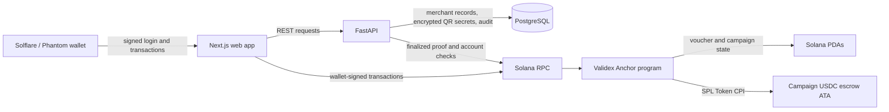

# MVP architecture

## Trust boundaries



- Wallet private keys remain with the customer or merchant, never with Validex.
- PostgreSQL supports discovery, reporting, and encrypted voucher secrets; it is not the source of truth for payment.
- The Solana program is the final authority for voucher ownership, stock, escrow, and one-time status.
- The API does not mark an off-chain voucher `active` before verifying the on-chain result at `finalized` commitment.

## Atomic purchase

1. The API creates a high-entropy voucher secret and sends only its hash to the transaction builder.
2. The customer signs `purchase_voucher` in a Solana wallet.
3. The program checks inventory and purchase limits, then transfers the full USDC price into campaign escrow.
4. The tracker verifies the program ID, account addresses, mint, amount, and voucher hash.
5. Only after a matching finalized transaction does the API make the voucher active.

## Atomic redemption

1. The merchant scans the QR secret; the API checks the active voucher and merchant/staff authorization.
2. The merchant signs a redemption transaction and sends it to the customer.
3. The customer adds a second wallet signature.
4. The program atomically marks the voucher `redeemed` and transfers escrow funds: 98% to the merchant, 2% to the treasury.
5. The API verifies the finalized transaction before updating reporting records.

Staff may verify a QR code, but only the merchant owner and customer can authorize redemption. After cancellation or expiry, the owner of an unused voucher can request a full escrow refund.

The on-chain voucher has three states. An API `pending_chain` purchase intent is **not** an on-chain voucher and must not be shown as paid.

```mermaid
stateDiagram-v2
    [*] --> Active: purchase_voucher + USDC escrow
    Active --> Redeemed: merchant and customer sign; 98% / 2% payout
    Active --> Refunded: cancelled or expired; customer signs full refund
```



## Amounts

All USDC amounts use integer minor units. The platform fee is 200 basis points (2%):

```text
commission = floor(gross_amount * commission_bps / 10_000)
merchant   = gross_amount - commission
```

Floating-point arithmetic is not used for token transfer amounts.
