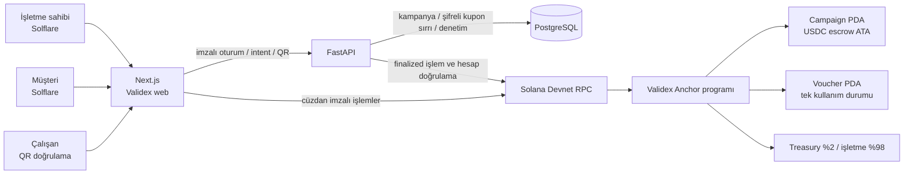

# Validex — Colosseum teslim paketi (taslak)

Bu belge bir **hazırlık paketidir**, tamamlanmış zincir dağıtımı veya çekilmiş video kanıtı değildir. `docs/roadmap.md` eski durum işaretleri yerine aşağıdaki doğrulama listesini kullanın. Colosseum'un güncel başvuru ekranındaki zorunlu alanları teslim günü tekrar kontrol edin.

## Durum ve dürüst demo sınırı

| İş | Mevcut durum | Tamamlanma kanıtı |
| --- | --- | --- |
| Anchor saf kural birim testleri | Kaynak kodda; çalıştırılmayı bekliyor | `cargo test -p validex --lib` çıktısı |
| Hatalı mint / yetkisiz kullanım / tekrar kullanım | Kural testleri var; gerçek hesap kısıtları yerel validator'da ayrıca sınanmalı | Başarısız işlemler, değişmeyen escrow ve voucher hesabı |
| Solflare satın alma E2E | Bloke: dağıtılmış program, mint, cüzdan ve test bakiyesi yok | İşlem imzası, `finalized` kaydı, API'de `active` kupon |
| Solana Devnet deployment | Bloke: CLI, yönetici public key'i, program keypair ve mint yok | Devnet `solana program show`, program ID, platform PDA |
| Demo verisi | `docs/demo-campaigns.json`; güvenli draft seed aracı | Yerel DB'de taslaklar; gerçek yayın zincir işlemiyle |
| Pitch / ürün demo videosu | Aşağıda senaryo hazır; kayıt ve yayın yapılmadı | İki ayrı video bağlantısı |

Gerçek işlem yapılmamışken demo verilerini `published`, `active` veya `redeemed` göstermeyin. Solflare imza onayı **kullanıcının kendi cüzdanında** yapılır; seed phrase/private key kayda veya repoya girmez.

## Mimari şema



Ödeme akışı: API `purchase-intent` ile 256-bit sır üretir → müşteri Solflare'de `purchase_voucher` imzalar → program tam USDC tutarını escrow'a taşır → API yalnızca beklenen program, mint, hesap, miktar ve `finalized` imza eşleşirse kuponu etkinleştirir. Kullanımda müşteri **ve** işletme imzası gerekir. İptal veya süre sonrasında kullanılmamış kupon için iade talebini kupon sahibi imzalar.

## Demo seed verileri

`docs/demo-campaigns.json` üç örnek kampanya metni ve en küçük USDC birimindeki fiyatları içerir. Aracın varsayılanı yalnızca önizlemedir:

```powershell
cd services/api
..\..\.venv\Scripts\python.exe scripts/seed_demo.py
```

Mevcut, doğrulanmış bir demo işletme cüzdanı ve yalnızca yerel **development** veritabanı hazırsa taslakları idempotent biçimde ekleyin:

```powershell
..\..\.venv\Scripts\python.exe scripts/seed_demo.py --apply --merchant-wallet <ISLETME_PUBLIC_KEY>
```

Bu işlem zincir adresi veya imza uydurmaz; taslaklar müşteri vitrininde satılabilir görünmez. Devnet kurulunca işletme, aynı içerikleri `/isletme` formundan kendi cüzdanıyla zincirde yayımlar. Bir fixture'ı gerçek kupon veya escrow ödemesi gibi sunmayın.

## Yerel test ve devnet devreye alma sırası

1. `cargo fmt --all -- --check`, `cargo test -p validex --lib`, `anchor build`, `anchor test` çalıştırın. Son iki komut yerel Solana validator ve uygun Anchor/Solana araç zincirini gerektirir. `anchor test` geçmeden devnet'e çıkmayın.
2. Yerel validator'da farklı mint, alıcı/işletme imzası eksikliği, ikinci kullanım, iki kez iade, yanlış escrow ATA, stok limiti ve transfer başarısızlığı senaryolarında işlemlerin atomik biçimde reddedildiğini doğrulayın. Kural testi hesap kısıtlarının yerine geçmez.
3. Yönetici, işletme ve müşteri için **yalnızca public key** adreslerini belirleyin. Program ID üretecek keypair yerel ve gizli kalmalı; repo içine konmamalı. Yönetici cüzdanında devnet SOL, müşteri cüzdanında test USDC ve işlem ücretleri için SOL bulunsun.
4. `VALIDEX_ADMIN_WALLET` değişkenini **Anchor derleme işleminin ortamına** aktarın. Bu adres programa derleme sırasında sabitlenir; sadece `.env` yazmak yeterli değildir. `anchor keys sync` sonrası `declare_id!`, `Anchor.toml` ve üretilen keypair aynı program ID olmalıdır. `anchor build` ile yeniden derleyin.
5. Solana CLI'da `solana config get` ile kümeyi kontrol edin. Devnet için `anchor deploy --provider.cluster devnet` kullanın; komut öncesi program ID, yükseltme yetkilisi ve kullanılacak cüzdanı tekrar doğrulayın. Sonrasında `solana program show <PROGRAM_ID> --url devnet` ile zincirdeki programı doğrulayın. [Anchor yerel test/deploy kılavuzu](https://www.anchor-lang.com/docs/quickstart/local), [Solana dağıtım kılavuzu](https://solana.com/docs/programs/deploying).
6. Platformu yalnızca sabit yönetici cüzdanıyla seçilen **6 decimal devnet mint** için başlatın. API `VALIDEX_SOLANA_PROGRAM_ID`, `VALIDEX_USDC_MINT`, web `NEXT_PUBLIC_VALIDEX_PROGRAM_ID`, `NEXT_PUBLIC_USDC_MINT` aynı gerçek adresleri kullanmalı. RPC URL'leri devnet olmalı. Treasury ATA'yı doğrulayın.
7. Yönetici zincirde işletmeyi kaydeder; işletme kampanyayı yayımlar. Müşteri Solflare ile satın alır; explorer'da `finalized` imza ve escrow artışı, API'de aktif kupon görülür. Aynı kupon tekrar kullanılmamalı. Kullanım ve iade için ayrı test kuponları kullanın.

### Solflare E2E kayıt kontrolü

- Tarayıcı devnet'te ve Solflare doğru müşteri cüzdanına bağlı. Kayıtta public key ve işlem imzası gösterilebilir; **özel anahtar, seed phrase, hassas oturum tokenı gösterilmez**.
- Kampanya sayfası ve fiyatı → `purchase-intent` → Solflare imza penceresi → işlem imzası → `confirmed` → `finalized` → `Kuponlarım` aktif QR.
- İşlem reddedilirse yeni kupon/ödeme otomatik oluşmamalı. Sayfa yenilenince pending kayıt zincirden kurtarılmalı.
- İşletme QR doğrulamasından sonra iki cüzdan imzası ile tek kullanım; ikinci deneme başarısız. Escrow, merchant ve treasury token bakiyeleri kontrol edilir.

## Colosseum için İngilizce açıklama taslağı

**Name:** Validex

**One-liner:** A Solana-powered marketplace that helps independent neighborhood businesses sell verifiable, single-use offers paid in USDC.

**Problem:** Local merchants need a simple way to reach nearby customers without handing coupon ownership and settlement to an opaque intermediary. Customers need confidence that a purchased offer exists, is still usable, and can be refunded under clear rules.

**Solution:** Merchants publish limited campaigns; customers buy vouchers with Solflare. USDC stays in a campaign escrow account until a customer and the merchant jointly approve redemption. An Anchor program enforces inventory, expiry, one-time use, refunds, and a 2% platform fee. A FastAPI service handles discovery, encrypted voucher secrets, QR checks, and finalized-transaction verification; it cannot move escrow funds on its own.

**Why Solana:** Low-cost transactions make small local offers practical. PDA-owned escrow and atomic token transfers make settlement and the customer refund path transparent.

**Current stage:** Working web/API prototype and Anchor contract; devnet deployment and real-wallet end-to-end proof **pending**. Replace this sentence only after recording the actual program ID and transaction links.

**Go-to-market hypothesis (not validated traction):** Pilot with a small cluster of independent cafes/restaurants in one neighborhood, then expand through merchant referrals and local creator partnerships. Add actual interviews, pilot metrics, team background and location before submission; do not invent traction.

**Repository:** https://github.com/BerzanBaran/Validex

## İki ayrı video için çekim planı

Colosseum'un güncel SSS'si 2–3 dakikalık **pitch** ve en çok 3 dakikalık **ürün demosu** istiyor; bunlar henüz üretilmedi. [Güncel hackathon SSS](https://colosseum.com/hackathon?year=fall2026).

| Süre | Pitch videosu | Ürün demo videosu |
| --- | --- | --- |
| 0:00–0:25 | Yerel işletmenin müşteri edinme sorunu | Validex ana sayfa ve müşteri vitrini |
| 0:25–0:55 | Hedef kullanıcı ve çözüm | İşletme başvurusu / kampanya oluşturma |
| 0:55–1:35 | Neden Solana, escrow ve ortak imza | Solflare satın alma ve finalized kupon (yalnızca gerçekten çalışıyorsa) |
| 1:35–2:10 | İş modeli: kullanımda %2 komisyon | QR doğrulama, kullanım, ikinci kullanımın reddi |
| 2:10–2:40 | Pilot planı ve gerçek kullanıcı geri bildirimi | İptal/iade ve mimari şema |
| 2:40–3:00 | Takım ve net kapanış | Program ID / explorer / repo, doğrulanmamış adım varsa açık not |

Videoların İngilizce anlatımı için yukarıdaki açıklamayı temel alın. Kayıt sırasında cüzdan onayını kullanıcı bizzat yapmalı. Pitch'te doğrulanmamış kullanım/gelir iddiaları yok; demo videosunda sahte zincir işlemi veya mock ödeme gerçek gibi gösterilmiyor. Başvuru portalına videoları ve takım bilgilerini kullanıcı yükleyecek.
