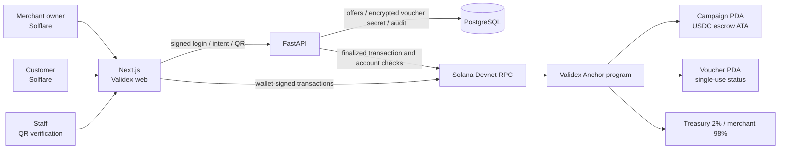

# Validex — Crypto World's Fair 2026 submission pack (draft)

This is a **preparation pack** with a verified Devnet program deployment, not proof of a completed wallet-to-wallet purchase or recorded video. The [current Colosseum FAQ](https://colosseum.com/hackathon?year=fall2026), [Crypto World's Fair page](https://colosseum.com/worldsfair), and [official rules](https://colosseum.com/legal/Crypto%20World%27s%20Fair%20Hackathon%20Rules.pdf) are the sources to recheck before submitting.

The official rules set the deadline at **October 12, 2026, 11:59 p.m. Pacific Time** (October 13, 09:59 in Türkiye). Do not wait for the final hour. Every team member must register; the team leader submits the product through the Colosseum platform. A team may submit only one product.

## What the submission portal asks for

| Material | Validex status / action |
| --- | --- |
| Product name and short description | `Validex`; refine the English description below for the final form |
| Blockchains and integrated tools | Solana, Anchor, SPL Token, Circle Devnet USDC, Solflare/Phantom, Next.js, FastAPI, PostgreSQL |
| Team members, backgrounds, and location | **User to provide**; every member must register and the leader must add them |
| Product logo or graphic | **User to provide or approve**; no final submission graphic is in this repository |
| GitHub repository | [Public Validex repository](https://github.com/BerzanBaran/Validex); confirm it remains accessible to judges |
| Presentation/pitch video | **Not recorded**; prepare a clear 2–3 minute video about the team, problem, product, and business opportunity |
| Product-demo video | **Not recorded**; prepare a separate video of at most 3 minutes showing the real product and Solana integration |
| Go-to-market, demand validation, and distribution | Pilot hypothesis below; add actual interviews, commitments, usage, or other evidence if obtained |
| Prior development disclosure | Disclose any work done before the contest or outside the public history, if applicable; the FAQ explicitly requires this |

The public Git history begins during the September 14–October 12 contest period, but that alone does not prove there was no earlier private work. Colosseum says existing code is allowed if relevant prior work is disclosed. Its judges want to see significant team work during the sprint and strategic feature prioritization, not a particular framework or polished pattern. Weekly one-minute progress videos are recommended, not strictly required. A public hosted demo is useful for accessibility but is **not listed as a mandatory form field** in the current FAQ; do not confuse it with the required product-demo video.

**Licensing decision:** The repository is public but currently has no `LICENSE` file. Public visibility is not the same as an open-source license. The team should choose and add a license only after confirming ownership and third-party asset rights; the rules explicitly ask entrants to account for third-party IP.

## Honest delivery status

| Item | Status | Completion evidence |
| --- | --- | --- |
| Anchor domain-rule unit tests | 9 passed | `cargo test -p validex --lib` output |
| Local validator transactions | Passed: wrong mint/escrow, unauthorized actions, replay, insufficient USDC, 2% fee, refund | `node apps/web/tests/validex-localnet.mjs` output |
| Solflare purchase E2E | Pending platform initialization, merchant/customer accounts, and test USDC | Signature, `finalized` proof, active voucher in API |
| Solana Devnet deployment | Program deployed; platform initialization pending | [Devnet program](https://explorer.solana.com/address/5ohDEoj3QVVXSG82Fwru8BMuLP45dLWCPrirquzenmbh?cluster=devnet), [deployment transaction](https://explorer.solana.com/tx/aD2TYH9rNgMAtpgpsUti4ToVvyCmrczsNVc4Gvmy2yF7nLdwnNpXwU2nxcNYGNcoP3DD1iXpbM4tffipGFrWyCB?cluster=devnet) |
| Demo data | Three templates and safe draft seed tool | Local draft records; real publishing requires an on-chain transaction |
| Pitch and product-demo videos | Storyboards below; not recorded or uploaded | Two video links |

Never show a campaign as `published` or a voucher as `active` or `redeemed` without a real transaction. The user approves Solflare prompts in their own wallet. Do not record or commit private keys, seed phrases, or access tokens.

## Architecture diagram



Purchase: the API creates a 256-bit secret with only its hash sent to `purchase_voucher`; the customer signs in Solflare; the program moves the exact USDC price to escrow; the API activates the voucher only after verifying a finalized transaction with matching program, mint, accounts, amount, and hash. Redemption requires **both** customer and merchant signatures. After cancellation or expiry, the owner of an unused voucher signs their own refund request.

## Demo seed data

`docs/demo-campaigns.json` contains three sample offer descriptions and prices in USDC minor units. The script previews data by default:

```powershell
cd services/api
..\..\.venv\Scripts\python.exe scripts/seed_demo.py
```

If a verified demo merchant already exists and the database is strictly local **development**, insert idempotent drafts:

```powershell
..\..\.venv\Scripts\python.exe scripts/seed_demo.py --apply --merchant-wallet <MERCHANT_PUBLIC_KEY>
```

The script fabricates no on-chain address or signature. Drafts are not purchasable in the customer marketplace. Once devnet is ready, the merchant publishes the same content from `/isletme` with their wallet.

## Test and devnet release sequence

1. Run `cargo fmt --all -- --check`, `cargo test -p validex --lib`, `anchor build --arch v2`, and the local-validator transaction test. The current Devnet cluster rejected the sBPFv3 build, so the deployed build uses sBPFv2.
2. On the validator, test a different mint, missing customer or merchant signature, second redemption, second refund, wrong escrow ATA, inventory limits, and transfer failure. Confirm that each rejected transaction leaves voucher and escrow state unchanged. Domain-rule tests do not prove Anchor account constraints.
3. Identify the admin, merchant, and customer **public keys**. Keep the program ID keypair local and private, outside the repository. Fund the admin with devnet SOL; the customer needs test USDC and SOL for fees.
4. Export `VALIDEX_ADMIN_WALLET` into the **Anchor build process**. The address is compiled into the program; an `.env` file alone is insufficient. After `anchor keys sync`, the keypair, `declare_id!`, and `Anchor.toml` must have the same program ID. Rebuild with `anchor build`.
5. Check `solana config get` for the intended cluster. Deploy only after checking the program ID, upgrade authority, and signing wallet. Verify with `solana program show <PROGRAM_ID> --url devnet`. The current program's upgrade authority is `Cwd8Y3CtzztBcY5dwhLgqBMywtJuKW86KdqqLGwH2Zc8`, not the temporary deployment account. See the [Solana deployment guide](https://solana.com/docs/programs/deploying).
6. Initialize the platform with the pinned admin and selected **six-decimal devnet mint**. API variables `VALIDEX_SOLANA_PROGRAM_ID` and `VALIDEX_USDC_MINT` must match web variables `NEXT_PUBLIC_VALIDEX_PROGRAM_ID` and `NEXT_PUBLIC_USDC_MINT`. Confirm both RPC URLs point to devnet and the treasury ATA is correct.
7. The admin registers a merchant on-chain; the merchant publishes an offer; the customer buys with Solflare. Check the finalized explorer transaction, escrow increase, and active voucher in the API. Use separate vouchers for redemption and refund tests.

### Solflare E2E recording checklist

- Confirm the browser is on devnet and Solflare connects the intended customer wallet. A public key and transaction signature may appear in the recording; a private key, seed phrase, or sensitive session token must not.
- Record offer and price → `purchase-intent` → Solflare approval → transaction signature → `confirmed` → `finalized` → active QR under My Vouchers.
- If a transaction fails, the app must not invent a successful voucher or resend a payment automatically. On refresh, recover pending records from the chain.
- After merchant QR verification, show the two-wallet signature flow, a successful single redemption, and rejection of a second attempt. Check escrow, merchant, and treasury token balances.

## English Colosseum description draft

**Name:** Validex

**One-liner:** A Solana-powered marketplace that helps independent neighborhood businesses sell verifiable, single-use offers paid in USDC.

**Problem:** Local merchants need a simple way to reach nearby customers without handing voucher ownership and settlement to an opaque intermediary. Customers need confidence that a purchased offer exists, is still usable, and follows clear refund rules.

**Solution:** Merchants publish limited offers; customers buy vouchers with Solflare. USDC stays in campaign escrow until the customer and merchant jointly approve redemption. An Anchor program enforces inventory, expiry, one-time use, refunds, and a 2% platform fee. FastAPI handles discovery, encrypted voucher secrets, QR checks, and finalized-transaction verification; it cannot move escrow funds itself.

**Why Solana:** Low-cost transactions make small local offers practical. PDA-owned escrow and atomic token transfers make settlement and refunds transparent.

**Current stage:** Working web/API prototype and Devnet-deployed Anchor contract (`5ohDEoj3QVVXSG82Fwru8BMuLP45dLWCPrirquzenmbh`). Platform initialization and real-wallet end-to-end purchase proof are still **pending**; do not claim completed live payments yet.

**Go-to-market hypothesis (not validated traction):** Pilot with a few independent cafes and restaurants in one neighborhood, then expand through merchant referrals and local creator partnerships. Add actual interviews, pilot metrics, team background, and location before submission; do not invent traction.

**Repository:** https://github.com/BerzanBaran/Validex

## Two separate video outlines

Colosseum's current FAQ asks for a **2–3 minute pitch** and a **product demo up to 3 minutes**. Neither has been recorded yet. See the [current hackathon FAQ](https://colosseum.com/hackathon?year=fall2026).

| Time | Pitch video | Product demo video |
| --- | --- | --- |
| 0:00–0:25 | Local customer-acquisition problem | Validex homepage and customer marketplace |
| 0:25–0:55 | Users and solution | Merchant application and offer creation |
| 0:55–1:35 | Why Solana, escrow, and joint signing | Solflare purchase and finalized voucher (only if working for real) |
| 1:35–2:10 | Business model: 2% on redemption | QR check, redemption, second attempt rejected |
| 2:10–2:40 | Pilot plan and real customer feedback | Cancellation/refund and architecture diagram |
| 2:40–3:00 | Team and clear close | Program ID, explorer, repo, and any honest limitation |

Use the English description above as the narrative starting point. The user must personally approve wallet prompts during recording. Do not present mocked transactions as real or claim unverified revenue. The user will upload the videos and team details to the submission portal.
